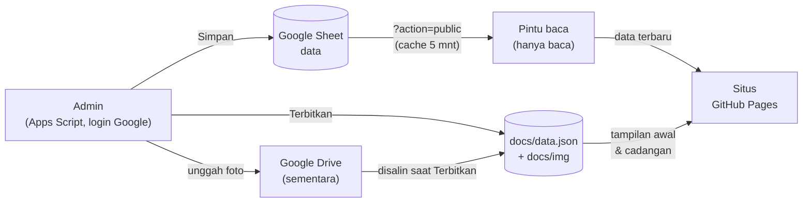

# Aksata Cerita

Website photobooth **Aksata Cerita** (Tulungagung): landing page statis yang cepat, dengan admin sederhana lewat Google Sheets + Google Apps Script. Tanpa server, tanpa biaya hosting.

| | |
|---|---|
| 🌐 Situs | https://aksatacerita.github.io/ |
| 📖 Panduan interaktif | https://aksatacerita.github.io/panduan.html |

> **Pemilik usaha / admin?** Buka panduan interaktif di atas — isinya langkah demi langkah, diagnosa masalah, dan checklist serah terima.
> README ini untuk **pengembang**.

## Daftar isi

- [Fitur](#fitur)
- [Cara kerja](#cara-kerja)
- [Struktur repo](#struktur-repo)
- [Model data (Google Sheet)](#model-data-google-sheet)
- [Admin & keamanan](#admin--keamanan)
- [Pengembangan](#pengembangan)
- [Deploy Apps Script](#deploy-apps-script)
- [Batas & risiko](#batas--risiko)
- [Pemecahan masalah](#pemecahan-masalah)
- [Kredit](#kredit)

## Fitur

- **Landing page statis** — paket & harga, katalog frame, galeri "Teman Cerita", Instagram feed, lokasi (peta), pemesanan sesi via WhatsApp, simulasi photobooth.
- **Admin** — tambah / ubah / hapus / sembunyikan, mode pilih massal, geser urutan (mouse & sentuh), unggah foto (otomatis dikecilkan di browser), info studio.
- **Perubahan tampil dalam detik** — situs membaca isi terbaru langsung dari Sheet; `data.json` hanya tampilan awal dan cadangan.
- **Cadangan permanen** — tombol *Terbitkan* menyalin data & foto ke repo ini lewat satu commit.
- **Tangguh** — kalau Google bermasalah, situs tetap tampil dari `data.json`.

## Cara kerja



1. **Simpan** di admin → tulis ke Sheet, cache pintu baca dihapus → situs ikut berubah dalam detik.
2. **Terbitkan** → `Code.gs` menyusun `docs/data.json`, menyalin foto Drive ke `docs/img/`, menghapus foto yang tak terpakai, lalu membuat **satu commit** lewat GitHub Git Data API. GitHub Pages membangun ulang (1–3 menit).
3. Saat pengunjung membuka situs: `data.json` → render (~0,4 dtk) → ambil dari Sheet → render ulang bila isinya berbeda (~2 dtk).

## Struktur repo

```
docs/                      Situs statis (GitHub Pages: branch main, folder /docs)
├── index.html
├── panduan.html           Panduan interaktif untuk admin
├── data.json              Salinan isi situs (diperbarui oleh Terbitkan)
├── .nojekyll              Nonaktifkan Jekyll (build lebih cepat & stabil)
├── css/                   reset.css, site.css
├── js/
│   ├── config.js          DATA_URL & API_URL (sumber data)
│   ├── main.js            Muat data.json → render → segarkan dari Sheet
│   ├── render.js          Mengubah data menjadi HTML halaman
│   └── interactions.js    Menu, drawer pesan, filter, booth, dll.
├── img/frames, img/gallery
└── assets/, favicon.svg

apps-script/               Admin & API (Google Apps Script, dikelola dengan clasp)
├── Code.gs                Backend: Sheet, API publik, upload, Terbitkan
├── Admin.html             Antarmuka admin
└── appsscript.json        Manifest (scope, pengaturan web app)
```

## Model data (Google Sheet)

Satu tab per jenis. **Baris pertama = judul kolom** (jangan diubah), **kolom `id` jangan disentuh**, **urutan baris = urutan tampil**.

| Tab | Kolom |
|---|---|
| `Paket` | id, aktif, nama, deskripsi, durasi, satuan_durasi, catatan_harga, harga, gaya_harga (`k`/`rp`), harga_coret, harga_addon, teks_addon, tag, warna, fitur (satu poin per baris), unggulan |
| `Frame` | id, aktif, nama, gambar, label, jenis, ukuran, warna |
| `Galeri` | id, aktif, judul, gambar, kategori |
| `Instagram` | id, aktif, link |
| `Pengaturan` | kunci, nilai (nama studio, alamat, koordinat, kontak, teks hero, bagian yang ditampilkan, daftar pilihan cepat, meta SEO) |

Kolom teks diformat **teks biasa** supaya locale Indonesia tidak merusak desimal (mis. koordinat `-8.0725342`). Kolom `gambar` berisi path relatif (`img/gallery/x.webp`) atau URL Drive sebelum diterbitkan.

`docs/data.json` memakai bentuk yang sama dengan keluaran `?action=public` (`settings`, `packages`, `frames`, `gallery`, `instagram`, `updated_at`) — hanya item `aktif`.

## Admin & keamanan

- **Login = akun Google.** Web app admin dijalankan sebagai *pengguna yang mengakses*; hanya email di `ADMIN_EMAILS` (Script properties) yang diterima, dan orang itu harus Editor Sheet.
- **Pintu baca publik** adalah deployment terpisah (dijalankan sebagai pemilik, akses siapa saja) dan hanya mengeluarkan JSON isi situs. Tidak ada fungsi tulis yang bisa dipanggil dari sana.
- **Rahasia tidak ada di repo.** Token GitHub (`GITHUB_TOKEN`) dan daftar admin hanya di *Script properties*. Token berupa fine-grained PAT, hanya untuk repo ini, izin *Contents: Read and write*.
- Repo ini **publik**: jangan commit token, `.env`, atau data pribadi.

Script properties yang dipakai:

| Kunci | Isi |
|---|---|
| `ADMIN_EMAILS` | email admin dipisah koma (diisi otomatis oleh `setConfig()` dengan pemilik script) |
| `GITHUB_REPO` | `aksatacerita/aksatacerita.github.io` |
| `GITHUB_BRANCH` | `main` |
| `SITE_DIR` | `docs` |
| `GITHUB_TOKEN` | token (isi manual, rahasia) |

## Pengembangan

Pratinjau situs lokal:

```bash
cd docs
python3 -m http.server 8000      # buka http://localhost:8000
```

Situs tidak punya langkah build. Ubah berkas lalu muat ulang. Untuk mematikan pembaruan dari Sheet saat menguji, kosongkan `API_URL` di `docs/js/config.js`.

Catatan penting:

- Perubahan tampilan ada di `render.js` (HTML), `site.css` (gaya), `interactions.js` (perilaku). Semuanya dijalankan ulang setiap data diperbarui — hindari listener global yang menumpuk.

## Deploy Apps Script

```bash
cd apps-script
npx @google/clasp login                      # sekali, dengan akun pemilik script
npx @google/clasp push -f                    # unggah Code.gs, Admin.html, appsscript.json
npx @google/clasp create-version "catatan"   # buat versi tetap
npx @google/clasp list-deployments
npx @google/clasp update-deployment <deploymentId> -V <versi> -d "Admin vN"
```

Ada **dua deployment**, masing-masing terikat ke satu *versi*:

| Deployment | Execute as | Akses | Manifest saat membuat versi |
|---|---|---|---|
| Admin | User accessing | Anyone with Google account | `executeAs: USER_ACCESSING`, `access: ANYONE` |
| Publik (hanya baca) | Me | Anyone | `executeAs: USER_DEPLOYING`, `access: ANYONE_ANONYMOUS` |

Setelah mengubah kode: `push` → `create-version` → `update-deployment` untuk deployment yang terdampak. Kembalikan `appsscript.json` ke versi Admin setelah membuat versi publik. Aktifkan **Apps Script API** di <https://script.google.com/home/usersettings> agar clasp berfungsi. Jalankan `setConfig()` sekali dari editor untuk mengisi Script properties dasar. `.clasp.json` tidak ikut di-commit.

## Batas & risiko

- **Gratis berarti tanpa kontrak.** GitHub Pages dan Apps Script tidak punya SLA; aturan kuota bisa berubah.
- **Kuota Apps Script.** Pintu baca di-cache 5 menit dan dihapus tiap menyimpan. Jika trafik melonjak, kosongkan `API_URL`; situs tetap hidup dari `data.json`.
- **Build Pages** sesekali gagal atau lambat saat GitHub ada insiden (cek <https://www.githubstatus.com>). Situs tetap bisa diperbarui karena membaca dari Sheet, bukan dari build.
- **Akun** adalah satu titik kegagalan: aktifkan 2FA, simpan kode cadangan, pastikan pemulihan akun benar.
- **SEO** sedikit lebih lemah dibanding situs yang dirender server, karena isi dirender di browser (judul & deskripsi dasar ada di `index.html`).
- **Cadangan manual** disarankan tiap ±3 bulan: unduh Sheet (.xlsx) dan ZIP repo.

## Pemecahan masalah

| Gejala | Penyebab & solusi |
|---|---|
| Admin: "Akses ditolak" | Email belum di `ADMIN_EMAILS` atau login ke akun Google yang salah |
| "Tidak dapat membuka file" di admin | Browser memakai akun lain; pakai jendela privat atau tambahkan `/u/N/` pada URL |
| Terbitkan `GitHub 401` | Token salah / dihapus → buat ulang, ganti `GITHUB_TOKEN` |
| Terbitkan `GitHub 403` | Izin token belum *Contents: Read and write* |
| Terbitkan `GitHub 404` | `GITHUB_REPO` salah atau token tak punya akses |
| Situs tidak berubah setelah Simpan | Refresh keras; tunggu cache pintu baca; cek bahwa `API_URL` terisi |
| Koordinat rusak (`-80.412.672`) | Kolom Sheet berformat angka; pastikan format **teks biasa** (dilakukan `Siapkan sheet`) |
| Build Pages `errored` | Cek githubstatus.com; hindari menekan Terbitkan berulang kali |
| Gambar "!" di admin | Unggahan belum selesai/gagal; unggah ulang |

## Kredit

Dibuat oleh **Tim RPL SMKN 1 Boyolangu** — <https://tim-rpl-rho.vercel.app>
